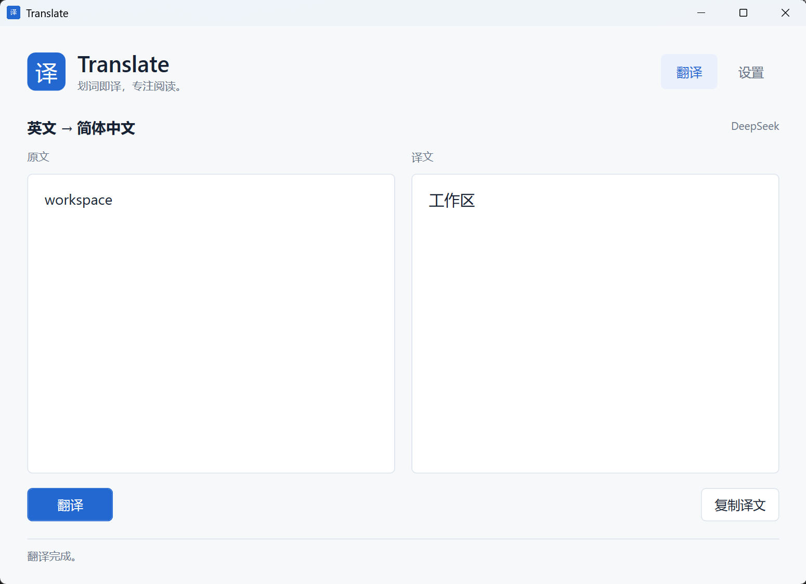
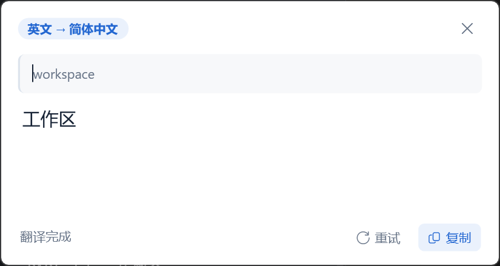
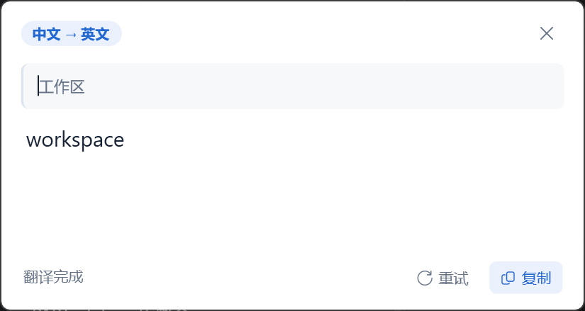

# Translate

一个个人维护的 Windows 桌面翻译工具。选中文字、长按右键，即可在鼠标附近查看大模型译文；也可以直接输入中文或英文翻译。界面保持简洁，使用自己的 API 服务。

| 英文 → 简体中文 | 中文 → 英文 |
| --- | --- |
|  |  |

截图来自实际 WPF 窗口，以模拟响应展示“workspace / 工作区”，只保留软件区域。

## 下载安装

**Windows 10 1809 及以上 / Windows 11，x64。**

前往 [最新 Release](https://github.com/Drowndreamer/Translate/releases/latest) 下载：

- **Translate-Setup-版本.exe**：推荐。默认当前用户安装，创建开始菜单入口，可选桌面快捷方式；可正常卸载和覆盖升级。
- **Translate-Portable-版本-win-x64.zip**：便携版，完整解压后双击 Translate/Translate.exe。不要只复制 EXE，运行依赖在同一目录。
- **SHA256SUMS.txt**：安装包和 ZIP 的校验值，可用 Get-FileHash 文件路径 -Algorithm SHA256 核对。

两种分发都包含 .NET 运行依赖。安装包暂未代码签名，Windows 可能显示未知发布者或 SmartScreen 提示；请核对仓库下载来源和校验值。详细步骤见 [使用说明](使用说明.md)。

## 功能与使用

- DeepSeek 和自定义 Chat Completions 兼容接口，API 地址、模型和 Key 可视化配置。
- 中文自动译为英文，英文自动译为简体中文；流式显示译文。
- 选中文字后长按右键约 0.3 秒唤起浮窗，长按时长可在设置中调整；短按保留目标软件菜单，移动保留右键拖动。
- 拖动浮窗四边或四角改变大小，本次运行保留调整后的尺寸。
- 浮窗原文可以编辑或粘贴：Enter 翻译，Shift+Enter 换行；“重试”使用当前输入。
- 复制译文、Esc / 外部点击关闭、系统主题跟随、托盘驻留和单实例。

**首次启动**：打开设置，填写自己的 API Key，确认 API 地址与模型名称，测试连接后保存。项目和发布包不包含任何预置 Key。

关闭主窗口后应用仍在托盘运行；双击托盘图标或再次运行程序可打开主界面，托盘菜单可暂停右键翻译或退出。不默认设置开机自启。

## 数据与隐私

**选中文字及手动输入的待翻译文本会发送给你自行配置的大模型服务。** 应用没有自己的转发服务器，也不保存翻译历史；服务商的数据处理方式由其政策决定。

API Key 通过 Windows DPAPI 当前用户加密，保存在 %LOCALAPPDATA%/Translate/settings.json。安装与便携版共享这个当前用户配置，升级保留配置，卸载默认也保留。需要清除时先退出程序，再自行删除该目录；不要把配置上传到 GitHub。

## 开发与构建

项目采用 C# / WPF / .NET 10，Windows x64，无第三方 NuGet 运行依赖。开发需要 Git、PowerShell 7、.NET 10 SDK；打包另需 Inno Setup。工具通过 PATH、安装注册表或显式参数发现，没有写死本机 SDK 路径。

~~~powershell
# 编译 + 不接触桌面输入或剪贴板的自动检查
./build.ps1 -CI

# 编译 + 本机逻辑和剪贴板检查
./build.ps1

# 安装固定版本官方 Inno Setup 编译器（一次），然后完整打包
$env:ISCC_PATH = & ./scripts/install-inno.ps1
./build.ps1 -Package

# 已安装编译器也可通过 PATH 或参数指定
./build.ps1 -Package -IsccPath '工具目录/ISCC.exe'

# 开发启动与本机交互验证
 dotnet run --project src/Translate/Translate.csproj
 dotnet run --project tests/Translate.Tests/Translate.Tests.csproj -- --ui artifacts/qa

# 桌面稳定性与流式显示基准（模拟 API，输出截图和 metrics.json）
 dotnet run --project tests/Translate.Tests/Translate.Tests.csproj -- --reliability artifacts/qa-reliability
~~~

完整打包命令为 ./build.ps1 -Package，输出在 artifacts/releases/版本/，包含安装包、便携 ZIP 和 SHA256SUMS.txt。发布版本只维护 Directory.Build.props 中的 Version；安装脚本、构建文件名和标签检查均读取此处。

**测试范围**：-CI 执行语言检测、请求/SSE、异常响应大小限制、取消、线程隔离、诊断脱敏、端点处理、DPAPI 临时配置及隔离单实例检查，不调用真实服务，不安装鼠标钩子、不操作剪贴板。--unit 另检查本机剪贴板；--ui 会移动鼠标、启动独立测试窗口、Edge、记事本和隔离配置的 VS Code。交互测试需在本机主动执行，结束后恢复剪贴板与鼠标位置；不要放进无人值守 CI。

GitHub Actions 的 main push 和 PR 执行自动检查；v* 标签推送构建并发布对应 Release。手动触发打包仅生成 Actions 构建产物。工作流采用官方 Actions 并固定提交 SHA。维护步骤见 [贡献与日常迭代](CONTRIBUTING.md)，实际本机结果见 [验证记录](验证记录.md)，版本变化见 [CHANGELOG](CHANGELOG.md)。

## 当前限制

暂不支持 OCR、历史记录、多配置、键盘触发、自动更新和 ARM64 原生构建。单次原文最多 20000 字符，超限请分段翻译；只处理可选中或可复制的文字；中英混合内容根据主要语言判断。高权限目标程序可能无法取词，可直接将文字粘贴到浮窗或主窗口。

尚未在第二台设备或混合缩放双屏上全面复测。安装包未代码签名，CI 自动检查不代表所有桌面交互都已验证。

异常诊断保存在 %LOCALAPPDATA%/Translate/diagnostics，最多保留两个 256 KiB 文件，仅包含异常类型与方法栈，不包含翻译内容、Key 或接口地址。稳定性与性能实测见 [0.2.2 验证记录](docs/reliability-2026-11-10.md)。

问题请提交 [Issue](https://github.com/Drowndreamer/Translate/issues)，不要附带 Key、密码、配置文件或个人信息。

## 许可证

[MIT](LICENSE)，Copyright © 2026 Drowndreamer。
